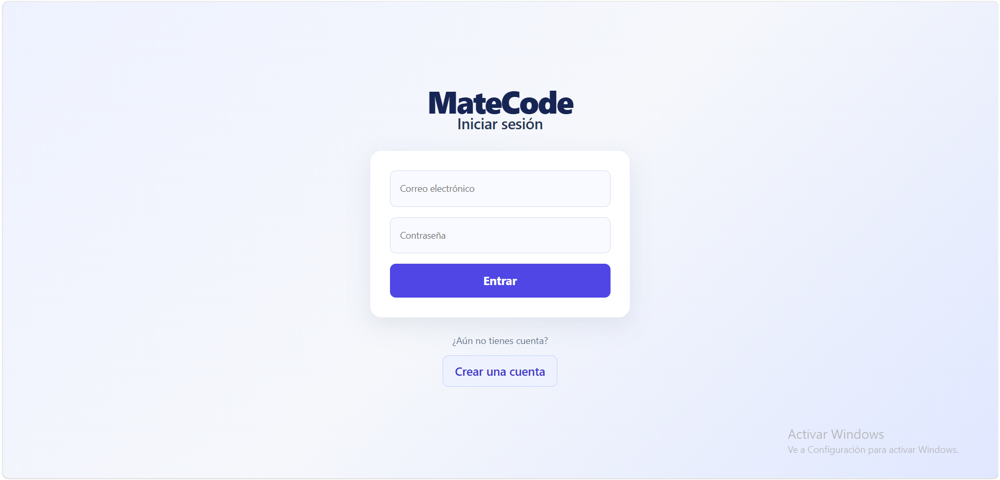
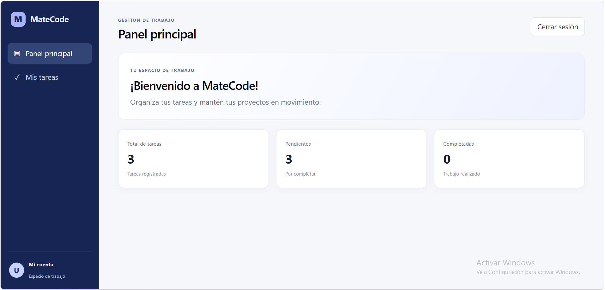
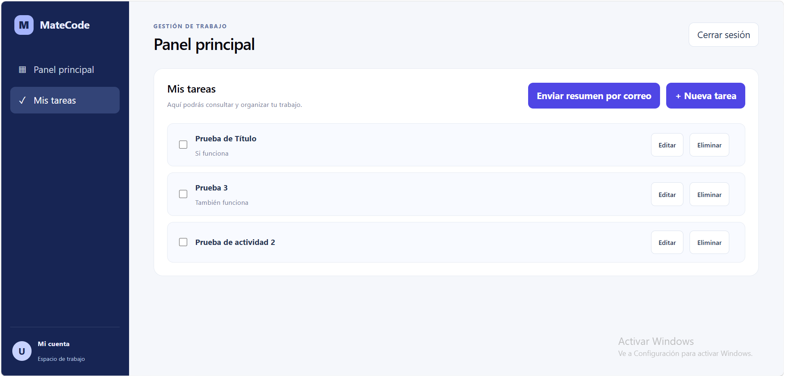
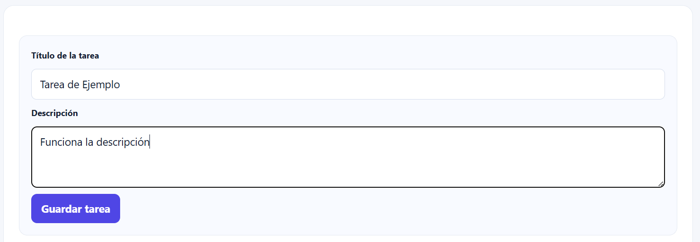
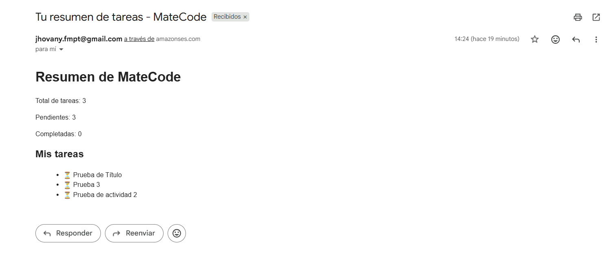

# MateCode

**Aplicación web para organizar y gestionar tareas personales.**

MateCode es una aplicación web de gestión de tareas que permite a los usuarios crear una cuenta, iniciar sesión y administrar sus actividades desde un espacio de trabajo personal.

La aplicación utiliza Firebase para la autenticación y persistencia de datos, y AWS SES para enviar resúmenes de tareas por correo electrónico mediante una función serverless desplegada en Vercel.

## Características principales

- Registro e inicio de sesión con correo electrónico y contraseña.
- Persistencia de sesión mediante Firebase Authentication.
- Gestión de tareas: crear, consultar, editar, completar y eliminar.
- Sincronización de tareas en tiempo real mediante Firestore.
- Panel principal con indicadores de tareas totales, pendientes y completadas.
- Envío de resumen de tareas por correo electrónico.
- Interfaz adaptable a diferentes dispositivos.
- Pruebas automatizadas con Vitest y React Testing Library.

## Demostración de la aplicación

### 1. Inicio de sesión


### 2. Panel principal


### 3. Gestión de tareas


### 4. Creación y edición de tareas


### 5. Envío de resumen por correo


## Tecnologías utilizadas

| Tecnología | Aplicación |
|---|---|
| React | Construcción de interfaces |
| TypeScript | Tipado estático |
| Vite | Entorno de desarrollo y compilación |
| Firebase Authentication | Autenticación de usuarios |
| Cloud Firestore | Persistencia de datos |
| AWS SES | Envío de correos electrónicos |
| Vercel | Despliegue y funciones serverless |
| Vitest | Pruebas automatizadas |
| React Testing Library | Pruebas de componentes |

## Arquitectura del proyecto

MateCode utiliza una arquitectura organizada por responsabilidades, separando la interfaz de usuario, los servicios de autenticación, la gestión de tareas y las integraciones externas.

### Estructura de carpetas

```text
MateCode/
├── api/
│   └── send-summary.ts
├── public/
├── src/
│   ├── assets/
│   ├── auth/
│   │   ├── AuthForm.tsx
│   │   ├── AuthForm.test.tsx
│   │   └── authService.ts
│   ├── lib/
│   │   └── firebase.ts
│   ├── tasks/
│   │   └── taskService.ts
│   ├── test/
│   │   └── setup.ts
│   ├── App.tsx
│   ├── App.test.tsx
│   ├── App.css
│   ├── index.css
│   └── main.tsx
├── .env.example
├── .gitignore
├── index.html
├── package.json
├── package-lock.json
└── README.md
```

### Responsabilidades principales

- **src/auth:** contiene el formulario y los servicios relacionados con el registro y la autenticación de usuarios.
- **src/tasks:** contiene la lógica de acceso y administración de tareas en Firestore.
- **src/lib:** centraliza la configuración de Firebase.
- **src/test:** contiene la configuración de las pruebas automatizadas.
- **api:** contiene las funciones serverless de Vercel. La función `send-summary.ts` integra Firebase Admin para verificar la autenticación y AWS SES para enviar correos electrónicos.

### Decisiones arquitectónicas

- React y TypeScript se utilizan para construir una interfaz tipada y organizada por componentes.
- Firebase Authentication administra las cuentas y sesiones de los usuarios.
- Cloud Firestore almacena las tareas asociadas a cada usuario.
- AWS SES se integra desde el backend para mantener protegidas las credenciales.
- Vercel Functions permite ejecutar operaciones del servidor sin exponerlas al navegador.
- Vitest y React Testing Library permiten verificar el comportamiento de los componentes.

Esta separación facilita el mantenimiento del código y permite identificar las responsabilidades de cada parte de la aplicación.

## Requisitos previos

- Node.js.
- npm.
- Una cuenta de Firebase.
- Una cuenta de AWS con Amazon SES configurado.
- Una cuenta de Vercel.
- Vercel CLI instalada para ejecutar las funciones serverless localmente.

## Instalación y ejecución local

1. Clonar el repositorio:

```bash
git clone https://github.com/jhovany50-lab/MateCode.git
```

2. Entrar al directorio:

```bash
cd MateCode
```

3. Instalar dependencias:

```bash
npm install
```

4. Configurar las variables de entorno en un archivo `.env.local`.

5. Iniciar el entorno de desarrollo:

```bash
npm run dev
```

**Nota:** Para probar la aplicación junto con las funciones serverless (incluido el envío de correos), utiliza:

```bash
vercel dev
```

El comando `npm run dev` inicia únicamente el servidor de desarrollo de Vite.

## Variables de entorno

El proyecto utiliza variables de entorno para configurar Firebase, Firebase Admin y AWS SES.

Para iniciar el proyecto localmente, crea un archivo `.env.local` en la raíz del proyecto y configura las siguientes variables con tus propias credenciales.

### Firebase (Frontend)

```env
VITE_FIREBASE_API_KEY=
VITE_FIREBASE_AUTH_DOMAIN=
VITE_FIREBASE_PROJECT_ID=
VITE_FIREBASE_STORAGE_BUCKET=
VITE_FIREBASE_MESSAGING_SENDER_ID=
VITE_FIREBASE_APP_ID=
```

Estas variables permiten conectar la aplicación con Firebase Authentication y Cloud Firestore.

### Firebase Admin (Backend)

```env
FIREBASE_PROJECT_ID=
FIREBASE_CLIENT_EMAIL=
FIREBASE_PRIVATE_KEY=
```

Estas credenciales son utilizadas exclusivamente por la función serverless para verificar los tokens de autenticación de Firebase.

### AWS SES (Backend)

```env
AWS_ACCESS_KEY_ID=
AWS_SECRET_ACCESS_KEY=
AWS_REGION=us-east-2
SES_FROM_EMAIL=
```

Estas variables permiten autenticar la conexión con Amazon SES y configurar el correo remitente.

**Seguridad:** las credenciales privadas de Firebase Admin y AWS SES nunca deben exponerse en el frontend ni publicarse en GitHub. El archivo `.env.local` está excluido del repositorio mediante `.gitignore`. En producción, estas variables se configuran desde Vercel.

El archivo `.env.example` contiene la plantilla de configuración sin credenciales reales.

## Base de datos y seguridad

MateCode utiliza Cloud Firestore para almacenar las tareas de cada usuario.

Las tareas se organizan mediante la siguiente estructura:

```text
users/
  {userId}/
    tasks/
      {taskId}
```

Las reglas de seguridad de Firestore restringen el acceso a las tareas para que cada usuario autenticado solamente pueda consultar y modificar sus propios registros.

## Envío de correos electrónicos

MateCode utiliza AWS Simple Email Service (SES) para enviar resúmenes de tareas mediante una función serverless de Vercel.

La función se encuentra en:

api/send-summary.ts

### Flujo de envío

1. El usuario solicita enviar su resumen desde la aplicación.
2. El frontend obtiene el token de autenticación de Firebase.
3. La solicitud se envía mediante una petición POST a `/api/send-summary`, incluyendo el token y la lista de tareas.
4. La función serverless verifica el token mediante Firebase Admin.
5. Se obtiene el correo electrónico asociado a la cuenta autenticada.
6. Se valida la información recibida y se genera el resumen.
7. AWS SES envía el correo electrónico en formato HTML y texto.
8. La aplicación muestra el resultado de la operación.

### Validaciones y seguridad

- Verificación del token de autenticación.
- Validación del correo electrónico.
- Validación de la estructura de las tareas.
- Límite máximo de 100 tareas por resumen.
- Uso de variables de entorno para las credenciales.
- Las credenciales de AWS y Firebase Admin permanecen exclusivamente en el servidor.

La función contempla respuestas de éxito y error para informar al usuario sobre el resultado del envío.

**Nota:** AWS SES en modo Sandbox solamente permite enviar correos a destinatarios verificados.

## Pruebas

El proyecto utiliza **Vitest** y **React Testing Library** para verificar el comportamiento de la aplicación y sus componentes.

Las pruebas se encuentran organizadas en los siguientes archivos:

- `src/App.test.tsx`: contiene 8 pruebas para verificar la autenticación, el panel principal, la gestión de tareas y el envío de resúmenes por correo.
- `src/auth/AuthForm.test.tsx`: contiene 5 pruebas para verificar el formulario de autenticación.

### Cobertura de pruebas

Las pruebas de la aplicación verifican:

- Visualización del formulario cuando no existe una sesión activa.
- Acceso al panel principal cuando el usuario está autenticado.
- Creación de tareas.
- Marcado de tareas como completadas.
- Eliminación de tareas.
- Manejo de errores durante el envío del resumen por correo.
- Confirmación visual cuando el correo se envía correctamente.
- Estado de carga durante el envío.

Se utilizan funciones simuladas (*mocks*) para aislar los servicios de autenticación y tareas, así como las solicitudes de envío de correo. Esto permite comprobar las respuestas de la interfaz sin depender directamente de los servicios externos.

### Ejecutar las pruebas

```bash
npm run test
```

Para ejecutar las pruebas en modo de observación:

```bash
npm run test:watch
```

**Resultado:** 13 pruebas distribuidas en 2 archivos.

## Compilación y despliegue

Generar la versión de producción:

```bash
npm run build
```

Ejecutar una vista previa de producción:

```bash
npm run preview
```

Para desarrollar y probar las funciones serverless localmente se puede utilizar:

```bash
vercel dev
```

El despliegue de producción se realiza mediante Vercel, conectado al repositorio de GitHub.

## Despliegue

- **Repositorio GitHub:** https://github.com/jhovany50-lab/MateCode
- **Aplicación en producción:** https://mate-code-eosin.vercel.app

## Uso responsable de inteligencia artificial

Durante el desarrollo de MateCode utilicé herramientas de inteligencia artificial como apoyo para resolver dudas técnicas, analizar errores y comprender conceptos relacionados con React, TypeScript, Firebase, AWS SES y Vercel.

### Aplicaciones principales

- **Resolución de errores:** apoyo para interpretar mensajes de error y encontrar posibles causas durante el desarrollo y despliegue.
- **Comprensión de código:** explicación de funciones, componentes, servicios y configuraciones para entender su propósito y funcionamiento.
- **Implementación:** orientación para desarrollar funcionalidades y conectar los diferentes servicios del proyecto.
- **Documentación:** apoyo para organizar y redactar la documentación técnica del proyecto.

### ¿Qué resultó más efectivo?

La estrategia más efectiva fue trabajar de manera gradual, abordando un problema a la vez y proporcionando el código o los mensajes de error correspondientes.

En lugar de aplicar soluciones sin revisarlas, comprobé los cambios mediante pruebas locales, ejecución de la aplicación y validaciones en el entorno de producción.

### Aprendizajes y buenas prácticas

- Utilizar la IA como herramienta de apoyo y no como sustituto de la comprensión técnica.
- Analizar las soluciones propuestas antes de incorporarlas al proyecto.
- Realizar cambios pequeños y comprobar su funcionamiento.
- Utilizar pruebas para detectar errores y verificar comportamientos.
- Proteger las credenciales y mantener la configuración sensible fuera del frontend y del repositorio.
- Consultar los mensajes de error y los registros de ejecución para identificar problemas.

La experiencia permitió comprender mejor el proceso de desarrollo, integración, pruebas y despliegue de una aplicación web.

## Autor

Proyecto Integrador - Módulo 4.

Desarrollado como parte del proceso de formación Full Stack.
